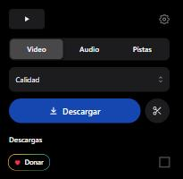

# mpeasy

Extensión para navegador que descarga canciones y videos de **YouTube, Facebook, Instagram y TikTok** en MP3 o MP4, directo desde la página que estás viendo.

  

## Qué hace

- Descarga el video abierto en **MP4** o solo el audio en **MP3**.
- **Pistas**: baja el video sin sonido y el audio por separado, listos para editar.
- **Recortar**: elegís desde dónde hasta dónde y baja solo ese tramo.
- Listas de reproducción y álbumes de YouTube: baja la lista completa en su carpeta.
- Clic derecho sobre un video o un link para descargarlo sin abrir la ventana.
- Elegís la calidad (hasta 1080p en video, hasta 320 kbps en audio).
- Aviso cuando termina, con botón para abrir la carpeta.
- Modo claro y modo oscuro.

### Atajos de teclado

| Atajo | Acción |
|-------|--------|
| `Ctrl+Shift+4` | Descargar el video en MP4 |
| `Ctrl+Shift+3` | Descargar el video en MP3 |
| `Ctrl+Shift+5` | Recortar un tramo del video |

## Instalación (Windows)

La extensión necesita un pequeño programa local que hace las descargas. El instalador lo prepara todo.

1. Entrá a la página de **[Releases](https://github.com/UiUyHerrera/yt-mp4/releases)** y descargá el archivo `yt-mp4.zip` de la versión más reciente.
2. **Descomprimí** el zip en una carpeta normal, por ejemplo `C:\YT MP4`. (No lo dejes dentro del zip ni en Descargas.)
3. Abrí la carpeta y hacé doble clic en **`install.bat`**.
   - Si no tenés Python, el instalador lo descarga e instala solo (unos 28 MB).
   - Instala `yt-dlp` y conecta el programa con tus navegadores (Chrome, Edge, Brave, Opera, Vivaldi y Firefox).
   - Si Windows no lo deja registrar, cerrá la ventana, hacé **clic derecho en `install.bat` → Ejecutar como administrador**.
4. Cargá la extensión en tu navegador:
   - **Chrome / Edge / Brave:** abrí `chrome://extensions`, activá el **Modo de desarrollador** (arriba a la derecha), tocá **Cargar descomprimida** y elegí la carpeta **`extension`** que está adentro del zip descomprimido.
   - **Firefox:** abrí `about:debugging#/runtime/this-firefox`, tocá **Cargar complemento temporal** y elegí el archivo `extension/manifest.json`.

Listo. Vas a ver el ícono de **mpeasy** en la barra del navegador.

## Cómo se usa

1. Abrí el video o la canción que querés bajar.
2. Tocá el ícono de **mpeasy**.
3. Elegí **Video**, **Audio** o **Pistas** y la calidad.
4. Tocá **Descargar**. El avance se ve en la lista de abajo y, al terminar, te avisa.

Para recortar un tramo, tocá las **tijeras** al lado de Descargar y marcá el inicio y el fin.

## Actualizaciones

Cada versión nueva se publica en Releases. Las actualizaciones encuentran la carpeta que usa tu navegador y se instalan ahí.

## Para desarrolladores

- `extension/` — la extensión (manifiesto, popup, service worker).
- `host/` — el programa local de Python que usa `yt-dlp` para descargar.
- `build.py` — arma `dist/yt-mp4.zip` con la extensión y el host.
- La publicación de releases es automática: al cambiar la versión en `extension/manifest.json`, el workflow de GitHub crea el release con las novedades que están en `popup.js`.

## Aviso

Descargá solo contenido sobre el que tengas derechos o que su licencia permita. Respetá los términos de cada plataforma y los derechos de autor.
